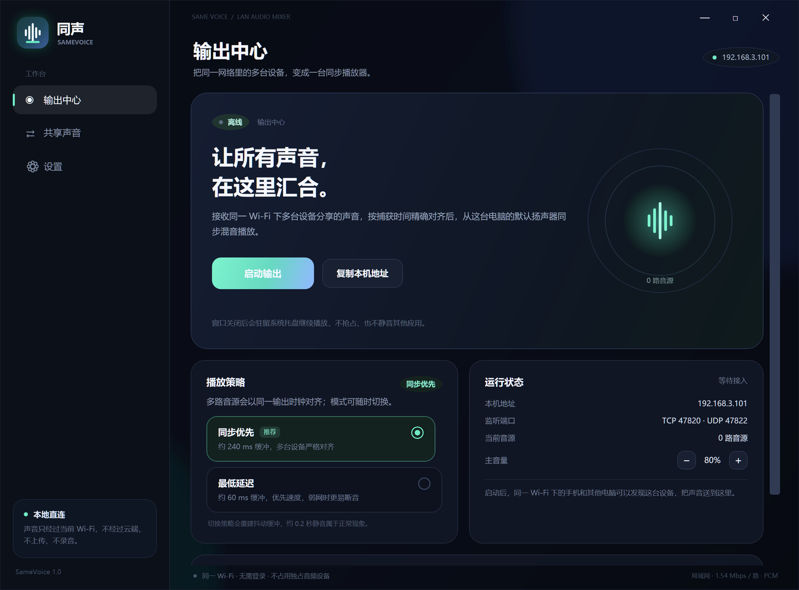
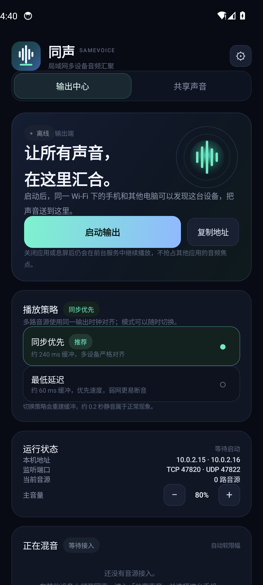

# 同声 SameVoice

> 把同一 Wi-Fi 下多台 Windows / Android 设备的声音，汇聚到其中一台设备同步播放。

同声是一个局域网音频汇聚与混音工具。每台参与设备采集“本机正在播放的声音”，将其编码为 48 kHz 立体声 PCM，经 UDP 发到用户选定的输出设备；输出设备完成时钟对齐与混音，从默认扬声器播放。它使用系统共享音频模式，**不会独占扬声器，也不会让其他应用静音**。

- **音频汇聚**：2–8 台设备的声音在同一台设备混音输出
- **独立音量**：Windows / Android 输出端都可以对每一路输入端单独调节音量
- **本机静音版**：Windows 本机静音但采集继续，输出端可用 Android「全满」到 100%
- **双路由版**：Voicemeeter/Scream 双路由，本机音量、本机静音与发送增益完全分离
- **Windows 音源固定增益**：Windows 音源采集后固定放大 4 倍（约 +12 dB），带软限幅
- **Scream 虚拟声卡接收**：Windows 安装 Scream 后，Android 可直接接收其局域网 PCM 流（单路模式）
- **两种策略**：同步优先（240 ms 缓冲，严格对齐）/ 最低延迟（120 ms 缓冲，优先响应）
- **后台播放**：Windows 关闭窗口驻留托盘；Android 前台服务 + WakeLock/Wi-Fi Lock
- **与其他软件共存**：Windows waveOut 共享模式 / Android AudioTrack 不申请音频焦点
- **系统声音采集**：Windows WASAPI loopback；Android MediaProjection 内部音频捕获
- **零账号、零云端**：不上传服务器，只走当前局域网

> 当前版本面向可信家庭/办公室局域网。传输没有加密，请勿在公共 Wi-Fi 使用敏感音频。





---

## 快速体验

发布包已经构建好，直接运行即可：

| 平台 | 文件 | 说明 |
| --- | --- | --- |
| Windows 1.2.0 本机静音版 | `dist/versions/mute/SameVoice-Windows-Portable/Start-SameVoice.cmd` | 只需本机静音、输出端最大 |
| Windows 1.4.1 双路由版 | `dist/versions/dualroute/SameVoice-Windows-Portable/Start-SameVoice.cmd` | 主音量 200%；手动缓冲 40–1000 ms；48k/24-bit |
| Android 10+ | `dist/android/SameVoice-1.1.5.apk` | 使用仓库内演示签名，允许侧载 |
| Android（调试版） | `dist/android/SameVoice-1.1.5-debug.apk` | 调试签名，便于 logcat |

两个 Windows 版本都已内置 .NET 8 运行时，并附带 Android 1.1.5 APK。完整选择说明见
[`dist/README.txt`](dist/README.txt)。

### 1. 选择版本

- **本机静音版**：Windows 共享页有「本机静音」按钮；本机静音时采集和输出端继续工作。
  Android「全满」按钮可把输出端主音量与每路音源都设为 100%。
- **双路由版**：共享页可分别选择「采集设备（B1 虚拟输出）」和「本机输出（A1 物理设备）」，
  并用「本机音量」「发送增益」两个滑杆独立控制两端。需要 Voicemeeter 做 A1/B1 双路由，
  步骤见 [`docs/DUAL-ROUTE.md`](docs/DUAL-ROUTE.md)。

### 2. 选择输出端

在准备作为扬声器的那台设备上打开同声，停留在「输出中心」，选择播放策略，点击「启动输出」。

- Windows：允许防火墙的“专用网络”访问。
- Android：前台服务会保持后台播放；录音授权会在共享声音时按需请求。通知栏控制需要你在系统设置中手动允许同声的通知权限（部分定制系统默认关闭）。

### 3. 接入音源

在另一台设备上打开同声，进入「共享声音」，点击「扫描输出设备」，选择刚才那台设备并点击「连接」。

- **Windows 音源**：无需额外授权，自动捕获默认播放设备上所有应用的系统声音。采集后固定放大 4 倍（约 +12 dB）并做软限幅；本机音量仍会影响采集电平。安卓输出端每路音量可独立往下调。
- **Android 音源**：会弹出系统“录制或投射屏幕”授权。请选择「整个屏幕」/「共享内部音频」，否则只会捕获部分应用；随后授予通知、录音权限。屏幕上的录屏状态图标是系统行为。

可以重复上述步骤，连接多台设备。输出端「正在混音」列表会显示每一路的缓冲和在线状态；Windows / Android 输出端都可以在每路右侧/下方拖动「音量」滑杆独立调节该输入端音量。

最低延迟模式使用 120 ms 抖动缓冲，适合稳定的 5 GHz Wi-Fi；如果网络仍有波动，优先使用同步优先模式。

### 4. 播放

输出端打开音乐、视频或会议声音后，所有音源设备正在播放的声音会一起出现在输出端。输出端本地也可以继续使用其他应用，声音由系统混音，不会互相打断。

关闭 Windows 窗口时会弹出选择：最小化到系统托盘、直接退出或取消。选择托盘后同声继续驻留（即使当前没有播放），右键托盘图标可以完全退出；系统托盘不可用时按钮变为“最小化到任务栏”。Windows 11 可能把新图标放进任务栏的 ^ 隐藏区，点开后可以把同声拖到任务栏固定；如果托盘图标找不到，直接再次启动 SameVoice 会把已有窗口唤回，不会重复开进程。Android 可下拉通知栏停止前台服务。

### 5. Scream 虚拟声卡模式（可选）

如果 Windows 声音无法通过 loopback 正常共享，可安装第三方 **Scream** 虚拟声卡：

1. 按 [`docs/SCREAM.md`](docs/SCREAM.md) 安装 Scream 驱动（管理员权限；Windows 11 可能需要测试签名）。
2. 把 Windows 输出设备设为 Scream，格式建议 48 kHz/16-bit/立体声。
3. Android → 设置 → **Scream 虚拟声卡接收** → 开始接收。

Scream 默认发送到组播 `239.255.77.77:4010`；手机与电脑需在同一 Wi-Fi，UDP 4010
不能被防火墙/AP 隔离阻挡。此模式不经过同声协议，只接收单路 Scream 流，不参与多音源混音。

检测脚本：`tools/detect-scream.ps1`。

---

## 使用限制（请先读）

1. **输出端本身不采集自己**：Windows 的 WASAPI loopback 和 Android 的 MediaProjection 都会把“本应用播放的声音”一起捕获，若输出端同时作为音源会形成回环。因此输出端只负责接收与播放；如果需要输出端电脑自己的声音，请用另一台设备作为音源。
2. **只能在同一个 IPv4 局域网**：不支持跨网段、VPN、路由器 AP 隔离、访客网络。建议 5 GHz Wi-Fi 或千兆有线。
3. **带宽**：v1 不压缩 PCM，每路约 **1.54 Mbps** 上行 + 1.54 Mbps 下行到输出端。2–4 路在普通 5 GHz Wi-Fi 上可用；8 路需要较好的网络。
4. **Android 捕获限制**：受 DRM 保护的内容、通话/语音通信、部分 OEM 定制系统可能无法捕获；蓝牙耳机的系统音可能被路由，从而无法捕获。Android 10+ 且应用必须在前台服务中。
5. **同步精度受硬件与网络影响**：目标是对齐音源之间的采集时间。典型局域网可做到几十毫秒级；不同设备扬声器/蓝牙链路本身的延迟不在自动校准范围内。
6. **不加密、无 PIN**：每会话有随机 Token 防止误串流，但同网段仍可窃听；请只在可信网络使用。
7. **iOS/macOS 未实现**：当前仅交付 Windows 与 Android。
8. **输出端跟随系统默认播放设备**：切换默认声卡或蓝牙设备后需要停止/重新启动输出。Windows 输出使用默认设备，Android 输出使用系统媒体通道。
9. **切换播放策略**会重建抖动缓冲，约 0.2 秒静音属于正常现象。
10. **自动延迟回收**：当输出线程/设备持续落后，混音器会把排程原点前移并清空过期队列，避免延迟无限增长；这一瞬间可能听到一次短暂跳变。

---

## 架构

```
┌────────────────────────── 同一 LAN ──────────────────────────┐
│                                                              │
│  Windows 音源 ──┐                                            │
│  Android 音源 ──┤  UDP 5 ms PCM 分片     ┌────────────────┐  │
│  Android 音源 ──┼──────────────────────►│  输出端设备    │  │
│  Windows 音源 ──┘  NTP 式时钟校准        │ 抖动缓冲 + 混音│  │
│                                          │ AudioTrack /   │  │
│  发现：UDP 47821 广播/单播               │ waveOut 共享   │  │
│  控制：TCP 47820 JSON Lines              └───────┬────────┘  │
│  音频：UDP 47822                                  │           │
│                                          ┌───────▼────────┐  │
│                                          │ 默认扬声器/蓝牙 │  │
│                                          │ 与其他应用混音  │  │
│                                          └────────────────┘  │
└──────────────────────────────────────────────────────────────┘
```

- 音频格式：48 kHz、立体声、PCM 16-bit，每包 240 帧（5 ms），996 字节含包头，低于常见 1500 MTU。
- 同步：音源每 5 秒用 UDP 做一次 NTP 式四时间戳往返，估算 `主机单调时钟 - 本机单调时钟`；音频包携带换算到输出端时钟的采集时间。输出端按 `采集时间 + 目标缓冲` 排入统一输出帧时间线，所有音源共用同一个时间线，因此多路声音按采集时刻对齐。
- 混音：每路 5 ms 队列 + 软限幅；主音量和 Windows 端每路音量独立。
- 控制：每会话 32-bit session + 64-bit 随机 token；15 秒心跳超时清理。
- 可靠性：UDP 不重传；晚于播放窗口的包丢弃，宁可短暂静音也不拖慢其他音源。

详细字段与时钟算法见 [docs/PROTOCOL.md](docs/PROTOCOL.md)，线程模型与平台实现见 [docs/ARCHITECTURE.md](docs/ARCHITECTURE.md)。

---

## 目录

```
same_voice/
├── src/windows/
│   ├── SameVoice.Core/          # 协议、发现、时钟、混音、音源客户端（无第三方依赖）
│   └── SameVoice.App/           # WPF UI、WASAPI loopback、waveOut、托盘
├── src/android/app/             # 原生 Kotlin Android 应用（无 AndroidX 依赖）
├── tests/SameVoice.Core.Tests/  # 无框架依赖的控制台测试，54 项断言
├── tools/
│   ├── SameVoice.Probe/         # 合成正弦音源，用于协议/混音联调
│   ├── SameVoice.LoopbackProbe/ # WASAPI 采集 → 网络 → 混音全链路自测
│   ├── SameVoice.SinkProbe/     # 合成音源 + waveOut 播放缓冲/延迟验证
│   └── allow-firewall.ps1       # Windows 防火墙放行脚本
├── docs/
├── dist/                        # 预构建 Windows 便携版与 Android APK
└── scripts/                     # 构建/打包脚本
```

---

## 从源码构建

### 环境

- Windows 10 1903+ / Windows 11，x64
- .NET 8 SDK
- Android：JDK 17+、Android SDK Platform 34、Build-Tools 34
- 没有引入 NuGet / Maven 第三方库；首次 Android 构建需要下载 Gradle/AGP（仓库内已提供 wrapper）

### Windows

```powershell
# 仅构建
dotnet build src/windows/SameVoice.App/SameVoice.App.csproj -c Release

# 测试（54 项断言）
dotnet run --project tests/SameVoice.Core.Tests/SameVoice.Core.Tests.csproj

# 发布框架依赖目录
dotnet publish src/windows/SameVoice.App/SameVoice.App.csproj `
  -c Release -r win-x64 --self-contained false -p:PublishSingleFile=false `
  -o dist/windows
```

或使用脚本：

```powershell
./scripts/build-windows.ps1
```

便携版的内置运行时由 `scripts/package.ps1` 从已安装的 .NET 8 Desktop Runtime 复制（仅复制 `host/fxr`、`Microsoft.NETCore.App`、`Microsoft.WindowsDesktop.App`，无需安装）。

### Android

```powershell
cd src/android
./gradlew.bat assembleRelease
# 输出：app/build/outputs/apk/release/app-release.apk
```

或使用脚本：

```powershell
./scripts/build-android.ps1
```

仓库内 `app/keystore/samevoice-release.jks` 是**演示签名**，密码为 `samevoice2026`；正式分发请替换为你自己的密钥：

```kotlin
signingConfigs {
    release {
        storeFile file('keystore/your-release.jks')
        storePassword System.getenv("SAMEVOICE_STORE_PASSWORD")
        keyAlias System.getenv("SAMEVOICE_KEY_ALIAS")
        keyPassword System.getenv("SAMEVOICE_KEY_PASSWORD")
    }
}
```

---

## Windows 防火墙

首次启动输出端时，Windows 可能弹出防火墙提示；请允许“专用网络”。如果没有弹窗或已误点“取消”，以管理员身份运行：

```powershell
powershell -ExecutionPolicy Bypass -File tools/allow-firewall.ps1
```

脚本会为同声添加 TCP 47820–47829、UDP 47821–47822 的专用网络入站规则。手机扫描不到电脑时，请依次检查：

1. 两台设备是否在同一 Wi-Fi/子网（Windows `ipconfig`，手机 Wi-Fi 详情）
2. 路由是否开启 AP 隔离/访客网络
3. Windows 防火墙是否放行
4. 是否使用了会拦截 UDP 的“游戏加速/安全软件”

---

## 已知问题与排查

| 现象 | 处理 |
| --- | --- |
| 手机扫描不到 Windows 输出端 | 防火墙专用网络放行；关闭 AP 隔离；手动输入 IP |
| 输出端没有声音 | 确认默认扬声器可用；Windows 音量合成器里同声未被静音；重新启动输出 |
| 音源显示“正在混音”但输出端无声 | 确认音源确实在播放声音；Android 是否选了整个屏幕；受 DRM 保护的内容无法捕获 |
| 声音断续 | 切换到「同步优先」；靠近 5 GHz 路由；减少同时接入设备；关闭其他大流量下载 |
| Windows 输出有杂音/爆音 | 升级到 Windows 1.1.3 + Android 1.1.0；最低延迟缓冲 120 ms；Android 采集缓冲 80 ms |
| Windows 扫描设备反复弹窗 | 升级到 Windows 1.0.3 或更高；旧版设备卡片的只读属性被按 TwoWay 绑定，现已改为单向绑定并限制异常弹窗次数 |
| Windows 托盘图标看不到 | 升级到 Windows 1.0.7；新版改用原生 Shell_NotifyIcon 并记录错误码。若 `%LOCALAPPDATA%\SameVoice\tray.log` 中为 `error=5`，说明资源管理器与同声的权限级别不一致，请尝试以管理员身份运行同声，或把资源管理器重启为普通权限 |
| 多路声音不同步 | 使用「同步优先」；两台设备都保持 Wi-Fi 稳定；不同蓝牙耳机本身存在固定延迟差 |
| 输出端延迟突然变大 | 自动延迟回收已处理；仍持续出现请检查 CPU/音频驱动；重启输出 |
| 安卓打开即闪退 | 1.0.1 已加入启动崩溃恢复页；再次打开会显示「上次启动失败」并可以复制完整日志，请把日志发给开发者 |
| 停止后仍有托盘/通知 | Windows 右键托盘退出；Android 在通知中点“停止” |
| Android 无法启动共享 | 检查录音、通知权限；Android 14 选择“整个屏幕”；部分 OEM 需在系统设置中允许后台运行 |

---

## 安全说明

- 没有中心服务器，没有账号，没有上传行为。
- 局域网内任何拿到随机 64-bit Token 的人可以发送音频；Token 只在 TCP 握手中下发，不加密。
- 不在公共 Wi-Fi、宿舍共享网络等不可信环境使用。
- 不要把 APK/EXE 的来源交给不可信第三方；替换演示签名后再对外分发。

---

## 许可

MIT License。音频采集/播放仅使用操作系统公开 API，没有捆绑第三方音频库或编解码器。

## 开发状态

- Windows：输出端 / 音源端完整实现，已通过 WASAPI loopback → 网络 → 混音全链路自测（见 `tools/SameVoice.LoopbackProbe`）。
- Android：输出端 / 音源端完整实现，已通过 Kotlin 编译与 APK 构建；已在 Android 14（API 34）x86_64 模拟器上完成冷启动、启动输出、前台服务继续运行和页面切换验证，但未完成 iQOO/OriginOS 真机与 MediaProjection 授权路径验收。
- Android 1.0.1 加入了启动崩溃保护：如果主线程启动失败，下次打开会进入「同声上次启动失败」恢复页，可以直接复制完整错误日志；同时移除了启动时的通知权限弹窗和状态栏颜色设置，这两项在部分定制系统上存在兼容风险。
- Windows 1.0.2 修复了从 Android 音源输出时的杂音/爆音：音源改用连续采样时间轴，不再逐次 AudioRecord 回调重锚时间戳；输出缓冲加深；多路混音增加余量；软限幅更平缓。Android 1.0.2 同时包含此项时间戳修复。
- Windows 1.0.3 修复「共享声音 → 扫描设备」时因设备卡片中的只读属性被错误地按 TwoWay 绑定而反复弹出异常的问题；未处理异常弹窗也改为每次运行最多一次。
- Windows 1.0.4 / Android 1.0.3：最低延迟缓冲由 60 ms 提高到 120 ms，Android 采集缓冲增大到 80 ms 并使用高优先级音频线程，解决低延迟模式严重断音；Windows 输出端新增每路音源独立音量滑杆。
- Windows 1.0.5：托盘图标改为窗口显示后创建，先建立句柄再设为可见，优先使用内置图标；关闭窗口始终驻留托盘（没有播放时也一样），右键托盘退出。
- Windows 1.0.6：重新生成有效的 SameVoice.ico（16–256 多尺寸），修复旧 ico 损坏导致托盘/EXE 图标渲染为彩色噪点、系统通知区不显示的问题。
- Windows 1.0.7：托盘改用原生 Shell_NotifyIcon，记录 NIM_ADD 错误码和图标矩形，支持 Explorer 重启恢复；注册失败时关闭窗口会最小化到任务栏，不再隐藏。
- Windows 1.0.8：关闭窗口时弹出「最小化到托盘 / 直接退出 / 取消」选择；托盘不可用时自动改为「最小化到任务栏」，直接退出会先停止输出和共享。
- Windows 1.1.2：移除 1.1.0/1.1.1 的 WASAPI loopback 自动增益补偿；保留 Windows 本机音量滑杆和 Android 输出端每路音量，但本机音量会重新影响采集电平。
- Windows 1.1.3：Windows 音源采集后固定放大 4 倍（约 +12 dB），加入软限幅；不做自动补偿，本机音量仍会影响输出电平。
- Android 1.1.0：新增 Scream 虚拟声卡接收模式（UDP 组播 239.255.77.77:4010），可在 Android 直接播放 Windows Scream 流；同版本保留 1.0.4 的每路音量滑杆。
- Windows 1.2.0：分成「本机静音版」和「双路由版」。前者提供本机端点静音；后者提供采集/本机输出设备选择、本机音量与发送增益独立控制。
- Windows 1.2.1（双路由）：取消固定 4 倍源增益，B1 直通；软限幅拐点 0.98；默认发送增益 100%，保留动态。
- Windows 1.2.2（双路由）：固定 3 倍源增益，发送增益仍可调；在响度和动态之间折中。
- Windows 1.2.3（双路由）：取消固定增益，发送增益范围 0–600%；默认 100% 直通。
- Windows 1.3.0 / Android 1.1.2：新增标准 48k/16-bit 和高音质 48k/24-bit 传输选项；高音质使用 120 帧/包（2.5 ms）避免 UDP 分片，Android 输出改为浮点混音。
- Windows 1.3.1：本机静音后调节本机音量不再自动解除静音，调完音量后恢复静音状态。
- Windows 1.4.0 / Android 1.1.3：输出端新增 40–1000 ms 手动缓冲延迟滑杆；120/240 ms 预设仍保留。
- Windows 1.4.1 / Android 1.1.4：输出端主音量上限从 100% 提高到 200%；Android「全满」设为 200%。
- Android 1.1.5：AudioTrack 缓冲提高到约 100 ms，输出线程使用 urgent audio 优先级，修复其他软件先占用音频服务时的卡顿。
- 测试断言：54/54 通过。
