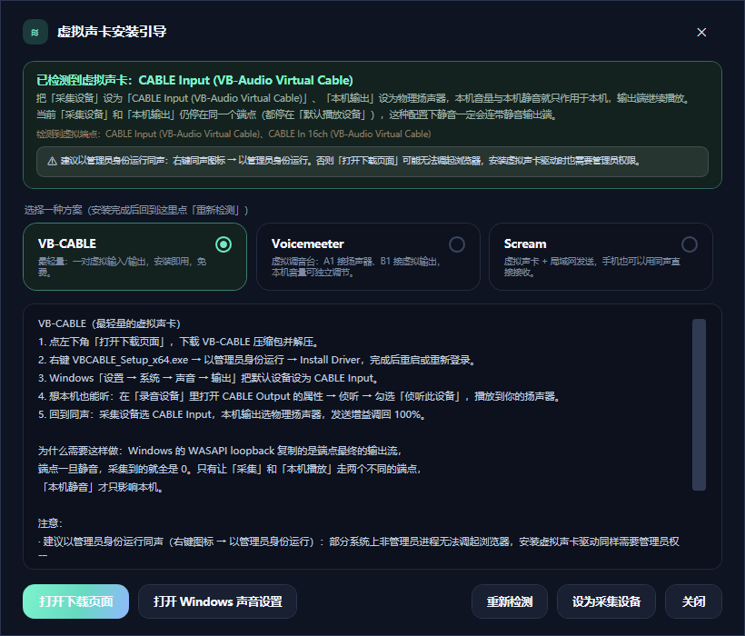

# 双路由版：本机与输出端音量彻底独立

Windows 1.5.1 DualRoute 版使用 **虚拟调音台 + 虚拟输出**，把同一条音频分成两条
互不影响的支路：

```text
Windows 应用
    │
    ▼
Voicemeeter Input（虚拟输入）
    ├── A1 → 物理扬声器/耳机      ← 本机音量，只影响本机
    └── B1 → Scream / VB-CABLE    ← 被同声采集，只影响输出端
```

这样：

- 本机音量调到 0 / 静音，不影响 B1 采集和 Android 输出
- Android 输出音量调到最大，不影响 Windows 本机
- 两端都可以在 0–100% 任意调节
- 不再需要自动补偿

## 需要安装的第三方组件

同声不捆绑这些驱动/软件，请自行安装：

1. **Voicemeeter Banana / Potato**（虚拟调音台，推荐）
2. 二选一作为 B1 虚拟输出：
   - **Scream** 虚拟声卡
   - **VB-Audio Virtual Cable**（CABLE Input）

Scream 安装说明见 `docs/SCREAM.md`。Voicemeeter / VB-CABLE 从其官网安装。

## 配置步骤

### 1. Voicemeeter 设置

1. 打开 Voicemeeter。
2. 在 **A1** 选择你的物理扬声器/耳机。
3. 在 **B1** 选择 Scream 或 `CABLE Input`。
4. 把 Windows 默认输出设为 **Voicemeeter Input**，或只把播放器输出设为
   Voicemeeter Input。
5. 播放音乐，确认本机 A1 有声音；此时 B1 也在发送。

### 2. 同声 DualRoute 设置

1. 打开同声 Windows 1.5.1 DualRoute。
2. 进入「共享声音」。
3. **采集设备**选择：
   - 如果 B1 接 Scream：选择 `Scream`
   - 如果 B1 接 VB-CABLE：选择 `CABLE Input`
4. **本机输出**选择 A1 实际连接的物理扬声器/耳机（不是 Voicemeeter Input）。
5. **本机音量**：控制第 4 步选中的物理设备音量，只影响本机。
6. **本机静音**：共享开始后可一键静音第 4 步选中的物理设备；静音后调节本机音量不会解除静音，调完会恢复静音。采集和输出端继续。
7. **发送增益**：控制送往输出端的流增益（0–600%）。默认 100%，B1 不做固定放大。
8. **传输音质**：标准 48k/16-bit 或高音质 48k/24-bit；两端都选高音质时生效，否则回退标准。
9. **手动缓冲延迟**：输出端可在 40–1000 ms 之间调整；越低延迟越小，但 Wi-Fi 抖动时更容易断音。
10. **主音量**：输出端主音量范围 0–200%；200% 会进入软限幅。
11. 连接 Android 输出端，开始共享。

> 采集设备必须是 B1 对应的虚拟设备，不能选物理扬声器；本机输出必须选 A1 的物理设备。
> 两者选对后，本机音量与输出端音量才真正互不影响。

### 3. Android 端

安装 Android 1.1.7，正常作为输出端；在输出端选择对应的传输音质和缓冲延迟，主音量可到 200%，每路音源音量仍可独立调整。

## 为什么这样能完全独立

- 采集的是 B1 的虚拟端点，物理 A1 音量不在采集链路上。
- 本机音量滑杆改的是第 4 步选中的物理输出，B1 不受影响。
- 发送增益是采集后的软件增益，只影响输出流；B1 不做固定放大。
- 高音质使用 24-bit PCM、120 帧/包（2.5 ms、720 字节），避免 UDP 分片，并且能整除常见 WASAPI 块。
- Android 的每路音量在输出端混音，不会反向影响 Windows。

## 如果没有 Voicemeeter

只安装 Scream 或 VB-CABLE 只能得到一条虚拟输出，不能同时保留本机扬声器。
可以用：

- **Audio Repeater**（VB-CABLE 附带）复制到物理设备；或
- Windows「侦听此设备」；或
- 安装 Voicemeeter。

没有双路由时，本机与输出端无法严格独立，只能使用「本机静音版」的静音方案。

## 应用内安装引导（Windows 1.5.1）

共享页的双路由面板会自动检测播放端点里的虚拟声卡：

- **没检测到**：面板顶部显示「未检测到虚拟声卡」，并说明此时采集与本机输出是同一个端点、
  点「本机静音」会把送往输出端的声音一起静音。点「安装引导」打开向导，选择 VB-CABLE /
  Voicemeeter / Scream 中的一种，按步骤安装。
- **检测到但没选它**：显示「已检测到虚拟声卡：…」，点「修复配置」打开向导，再点
  「设为采集设备」，会自动把采集设备设为虚拟端点、本机输出设为物理扬声器并保存。

向导里的「下载」按钮会打开对应官网，「打开 Windows 声音设置」直接跳到系统声音页；
装完驱动后点「重新检测」，识别到虚拟端点即可一键设置，不需要重启同声。
> 建议以管理员身份运行同声（右键图标 → 以管理员身份运行）：部分系统上非管理员进程
> 无法调起浏览器，安装虚拟声卡驱动时也需要管理员权限。
检测依据是播放端点名称里的 CABLE / Scream / Voicemeeter / Virtual，识别不到时请确认
驱动已经安装且设备未被禁用。



## 故障排查

| 现象 | 处理 |
| --- | --- |
| 采集设备列表没有 CABLE/Scream | 确认虚拟设备已安装且在 Windows 声音设置中启用；点刷新 |
| 本机有声音但 Android 没有 | B1 未路由到虚拟输出；检查 Voicemeeter B1 |
| Android 有声音但本机没有 | A1 未选择物理设备 |
| 两端音量仍互相影响 | 采集设备选错成物理扬声器；改选 B1 虚拟设备 |
| 本机静音后 Android 也没声 | 采集与本机输出是同一个端点；打开「安装引导」安装虚拟声卡，或把采集设备改到虚拟端点 |
| 声音太小 | 提高发送增益或 Android 输出端每路音量；Scream 高级设置用 48 kHz/16-bit/立体声 |
